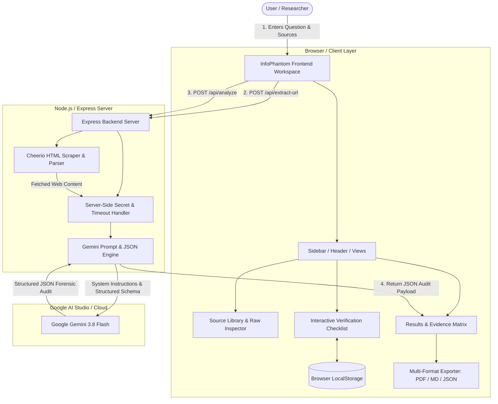
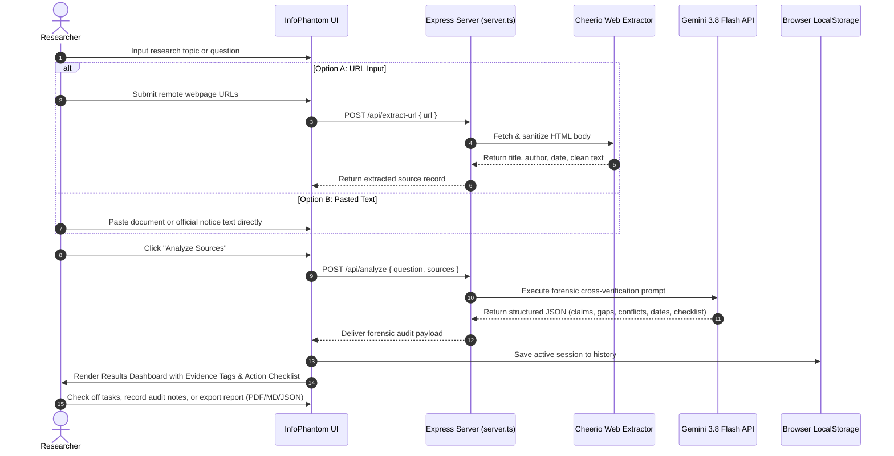

# InfoPhantom

> **Uncovers information hidden between scattered sources.**

[](https://github.com/ghorimohammedosman/infophantom-ai)
[](https://ai.google.dev/)
[](https://react.dev/)
[](https://tailwindcss.com/)
[](https://expressjs.com/)

---

## Table of Contents

- [A. Project Introduction](#a-project-introduction)
- [B. Problem Statement and Solution](#b-problem-statement-and-solution)
- [C. Key Features](#c-key-features)
- [D. Technology Stack](#d-technology-stack)
- [E. System Architecture](#e-system-architecture)
- [F. Complete Application Workflow](#f-complete-application-workflow)
- [G. How the AI Engine Works](#g-how-the-ai-engine-works)
- [H. Information Gap Detection Methodology](#h-information-gap-detection-methodology)
- [I. Example Demonstration (Northbridge Award)](#i-example-demonstration-northbridge-award)
- [J. Installation and Setup](#j-installation-and-setup)
- [K. Environment Variables](#k-environment-variables)
- [L. Project Folder Structure](#l-project-folder-structure)
- [M. API and Backend Workflow](#m-api-and-backend-workflow)
- [N. Screenshots & Visual Interface](#n-screenshots--visual-interface)
- [O. Limitations and Future Improvements](#o-limitations-and-future-improvements)
- [P. Security and Responsible AI](#p-security-and-responsible-ai)
- [Q. Testing and Verification](#q-testing-and-verification)
- [R. Deployment](#r-deployment)
- [S. Hackathon Project Information](#s-hackathon-project-information)
- [T. License and Contributing](#t-license-and-contributing)

---

## A. Project Introduction

**InfoPhantom** is an AI-assisted information gap detection and research verification platform. 

### Why Traditional Search and Summarization Are Insufficient
- **Search Engines** retrieve links based on keywords, leaving the user with dozens of fragmented tabs to read and cross-check manually.
- **AI Summarizers** compress existing text, repeating only what is explicitly written while remaining blind to what is omitted.
- **Chatbots** frequently hallucinate missing requirements or fill gaps with plausible-sounding assumptions rather than verifying absence.

### How InfoPhantom Solves the Information-Gap Problem
InfoPhantom goes one step further: it acts as a forensic research investigator. Instead of just answering *"What do these articles say?"*, it asks:
1. **What critical clauses or eligibility requirements are missing across all sources?**
2. **Where do sources contradict each other on mandatory requirements or dates?**
3. **Which sources reference past application cycles or expired deadlines?**
4. **What exact questions must the researcher ask primary authorities next?**

### Target Users and Practical Use Cases
| User Persona | Real-World Use Case |
| ------------ | ------------------- |
| **Students & Scholarship Applicants** | Verifying multi-year award renewal rules, GPA retention cutoffs, and conflicting income documentation prerequisites. |
| **Visa & Immigration Applicants** | Spotting unmentioned income thresholds, health insurance criteria, and outdated embassy circulars. |
| **Legal & Compliance Analysts** | Cross-auditing terms of service, privacy policy revisions, and statutory disclosures across jurisdictions. |
| **Academic & Policy Researchers** | Identifying literature blind spots, conflicting clinical trial parameters, and unverified data claims. |
| **Grant Writers & Entrepreneurs** | Evaluating government request-for-proposals (RFPs) to uncover hidden submission prerequisites. |

---

## B. Problem Statement and Solution

```
┌─────────────────────────────────────────────────────────────────────────────┐
│                            THE RESEARCH DILEMMA                             │
├──────────────────────────────────────┬──────────────────────────────────────┤
│ What You Typically Get               │ What You Actually Need               │
├──────────────────────────────────────┼──────────────────────────────────────┤
│ • 15 browser tabs open               │ • Cross-document synthesis           │
│ • Unnoticed omissions (Dark Spots)  │ • Explicit gap detection             │
│ • Conflicting document requirements  │ • Side-by-side claim comparison      │
│ • Archived/expired notices disguised │ • Cycle & publication freshness check│
│ • Vague AI hallucinations            │ • Verbatim quote & source anchors    │
└──────────────────────────────────────┴──────────────────────────────────────┘
```

InfoPhantom establishes a multi-source comparative baseline that classifies findings into a rigorous epistemological taxonomy:
- **Known Facts:** Directly supported by verbatim citations in the source material.
- **Silent Gaps (Dark Spots):** Crucial requirements unaddressed by any active document.
- **Divergences (Conflicts):** Contradictory criteria that could disqualify an applicant.
- **Chronological Pitfalls:** Expired deadlines or archived academic cycles.
- **Prioritized Checklist:** Step-by-step action items to verify before making high-stakes decisions.

---

## C. Key Features

The following 15 features are implemented in the InfoPhantom codebase:

1. **Research Question Input:** Dedicated input workspace with real-time suggestion presets (scholarships, compliance policies, remote work criteria).
2. **Multi-URL Submission (Option A):** Users can paste multiple web URLs. The backend fetches and parses remote documents with error telemetry.
3. **Pasted-Text Ingestion (Option B):** Ingest raw press releases, PDF extracts, institutional bylaws, or memos with title, URL, and date metadata.
4. **Server-Side Web Extraction:** Powered by Cheerio in `server.ts`. Automatically strips scripts, navigation, ads, and footers, extracting clean article content and metadata.
5. **AI-Powered Information Extraction:** Extracts important claims, eligibility conditions, dates, and amounts, anchoring each to its original source.
6. **Information Gap Detection (Dark Spots):** Forensic absence-testing that detects missing renewal clauses, absent selection rubrics, or missing appeal channels.
7. **Cross-Source Conflict Comparison:** Compares opposing claims side-by-side with verbatim quotations, divergence explanations, and reconciliation advice.
8. **Outdated Information Warnings:** Evaluates publication dates and cycle references (e.g. 2025/2026 vs. 2026/2027) to flag superseded guidance.
9. **Unanswered Research Question Generator:** Synthesizes high-impact follow-up inquiries targeted at specific custodian institutions.
10. **Evidence & Citation Transparency:** Every claim links directly to its source title, domain, URL, and verbatim excerpt.
11. **Raw Source Inspector:** In-app inspection modal allowing researchers to inspect full raw extracted text, word counts, and domain metadata.
12. **Prioritized Interactive Verification Checklist:** Action checklist categorized by priority (`CRITICAL`, `HIGH`, `MEDIUM`, `LOW`) with completion checkboxes, readiness percentage gauge, custom task creation, and audit note recording.
13. **Persistent Analysis History:** Saves research sessions and checklist progress in browser storage with instant search, reload, and deletion.
14. **Multi-Format Report Export:**
    - **Print / PDF Layout:** Formal paper-ready document using dedicated `@media print` CSS.
    - **Markdown (.md):** Structured documentation download for Notion, GitHub, or Obsidian.
    - **JSON Audit Package (.json):** Machine-readable structured payload of all claims and gaps.
    - **Summary Clipboard:** 1-click briefing copy for Slack or email.
15. **Built-in Northbridge Award Demonstration:** Pre-loaded, 1-click fictional scholarship scenario demonstrating the complete end-to-end audit workflow without needing external URLs.

---

## D. Technology Stack

| Layer | Technology | Version | Purpose & Implementation File |
| ----- | ---------- | ------- | ----------------------------- |
| **Frontend Framework** | React | `^19.0.1` | Core declarative UI architecture (`/src/App.tsx`) |
| **Language** | TypeScript | `^7.0.2` | End-to-end type safety and domain models (`/src/types/index.ts`) |
| **Build System** | Vite | `^8.3.0` | Ultra-fast development bundling and compilation (`/vite.config.ts`) |
| **Styling & Design System** | Tailwind CSS | `^4.3.3` | Utility-first dark-mode styling and print CSS (`/src/index.css`) |
| **UI Icons** | Lucide React | `^0.546.0` | High-fidelity research intelligence icons (`/src/components/*`) |
| **Animations** | Motion | `^12.23.24` | Micro-interactions and transition physics |
| **Backend Framework** | Express | `^4.21.2` | Full-stack Node API proxy and server (`/server.ts`) |
| **Runtime Execution** | TSX | `^4.21.0` | Direct execution of TypeScript server files in development |
| **AI Model** | Google Gemini 3.8 Flash | Latest | Core reasoning, gap detection, and JSON analysis (`gemini-3.8-flash`) |
| **AI SDK** | `@google/genai` | `^2.25.0+` | Official Google GenAI TypeScript SDK (`/server.ts`) |
| **Web Content Extraction** | Cheerio | `^1.0.0` | Server-side DOM parsing and HTML sanitization (`/server.ts`) |
| **State Persistence** | Browser `localStorage` | Native | Client-side session and checklist audit persistence (`/src/App.tsx`) |
| **Report Generation** | Print CSS / Web APIs | Native | Formal PDF formatting (`@media print`) and Blob download engines |

---

## E. System Architecture



---

## F. Complete Application Workflow



---

## G. How the AI Engine Works

### System Grounding Directives
The AI engine in `server.ts` uses Google's `gemini-3.8-flash` model with strict operational boundaries:
1. **Bounded Ingestion:** The model is forbidden from inventing citations, URLs, or facts outside the provided source material.
2. **Absence vs. Incomplete Extraction:** The engine explicitly distinguishes between an incomplete document fragment and a verified policy omission.
3. **Structured Schema Delivery:** Responses adhere to a strict JSON structure containing claims, gaps, conflicts, outdated notices, and checklists.

### Strict Verification Taxonomy

| Status Label | Epistemological Definition | Visual Indicator |
| ------------ | -------------------------- | ---------------- |
| `SOURCE-SUPPORTED` | Directly confirmed by verbatim text quotes in the source. | Emerald Badge & Checkmark |
| `POTENTIAL GAP` | Critical policy, prerequisite, or rule absent across all sources. | Cyan Badge & Radar Target |
| `POTENTIAL CONFLICT` | Direct contradiction between two or more sources. | Rose Badge & Git-Compare |
| `POSSIBLY OUTDATED` | Source references an expired academic cycle, past year, or old date. | Amber Badge & Clock |
| `AI SUGGESTION` | Actionable hypothesis synthesized by AI requiring primary confirmation. | Indigo Badge & Sparkles |

---

## H. Information Gap Detection Methodology

### Why Gap Detection Transcends Ordinary Summarization

```
Traditional Summarization:
Source Text: "The scholarship provides $7,500. Applicants need a 3.2 GPA and must apply by Nov 30."
Summary: "The award gives $7,500 to students with a 3.2 GPA before Nov 30."
(Notice: The summary fails to inform the student that renewal rules are missing!)

InfoPhantom Gap Detection:
Detected Dark Spot: "Renewal Terms & Multi-Year Continuation Rules Completely Absent."
Forensic Risk: Student may budget for a 4-year degree assuming $30,000, but funding might terminate after Year 1.
Recommended Action: Request the written Award Continuation Bylaws from the financial aid desk.
```

### Gap Detection Evaluation Criteria
1. **Core Domain Omission Check:** Evaluates whether standard operational pillars (eligibility, documentation, renewal, appeals, evaluation rubrics) are addressed.
2. **Severity Weighting:**
   - `CRITICAL`: Missing information that could cause disqualification or unexpected financial debt.
   - `HIGH`: Unspecified evaluation criteria (e.g., rolling admissions vs. batch deadlines).
   - `MEDIUM`: Absent extenuating circumstances or appeal protocols.
   - `LOW`: Secondary logistical details.
3. **Action Recommendation:** Converts every identified gap into an explicit query directed at custodian authorities.

---

## I. Example Demonstration (Northbridge Award)

> **Notice:** All data in this demonstration is simulated for evaluation purposes.

```
┌─────────────────────────────────────────────────────────────────────────────┐
│              SIMULATED DEMONSTRATION DATA — NOT A REAL NOTICE               │
└─────────────────────────────────────────────────────────────────────────────┘
```

The application includes an instant **"Load Sample Research"** preset based on the fictional **Northbridge Student Support Award**:

- **Source A (Simulated Official Notice):**
  - Outlines $7,500 grant, GPA 3.20 cutoff, and November 30, 2026 portal deadline.
  - Mandates an official **Certified Income Certificate issued by Revenue Authority**.
  - **Dark Spot:** Omits all multi-year continuation or sophomore renewal policies.
- **Source B (Simulated Educational Guide):**
  - Asserts that a **self-attested Income Declaration with W-2 transcript** is sufficient.
  - Mentions an unconfirmed 20-hour civic volunteering preference.
- **Source C (Simulated Previous-Year Notice):**
  - References the archived 2025/2026 cycle.
  - Lists an expired **October 15, 2025** deadline and superseded $45,000 income ceiling.

### Output Generated by InfoPhantom:
1. **Extracts Claims:** Identifies GPA 3.20, $7,500 grant, and portal submission rules.
2. **Detects Dark Spot:** Flags absence of sophomore renewal conditions (preventing multi-year debt traps).
3. **Exposes Conflict:** Highlights document conflict between Source A (official certificate) and Source B (self-attested form).
4. **Flags Outdated Source:** Warns against relying on Source C's expired October 15 deadline.
5. **Generates Checklist:** Creates a 6-step prioritized verification agenda.

---

## J. Installation and Setup

### Prerequisites
- [Node.js](https://nodejs.org/) v18.0.0 or higher (v20+ recommended)
- [npm](https://www.npmjs.com/) or [bun](https://bun.sh/)
- A Google Gemini API Key ([Get one free from Google AI Studio](https://aistudio.google.com/app/apikey))

### Step-by-Step Setup

1. **Clone the repository:**
   ```bash
   git clone https://github.com/ghorimohammedosman/infophantom-ai.git
   cd infophantom-ai
   ```

2. **Install project dependencies:**
   ```bash
   npm install
   ```

3. **Configure environment variables:**
   ```bash
   cp .env.example .env
   ```
   Open `.env` in your text editor and add your Gemini API key:
   ```env
   GEMINI_API_KEY="your_actual_gemini_api_key_here"
   PORT=3000
   NODE_ENV="development"
   APP_URL="http://localhost:3000"
   ```

4. **Start the full-stack development server:**
   ```bash
   npm run dev
   ```
   The application will boot at `http://localhost:3000` with Express backend API routes and Vite frontend middlewares active.

5. **Build for production:**
   ```bash
   npm run build
   ```

6. **Start production server:**
   ```bash
   npm run start
   ```

---

## K. Environment Variables

| Variable | Description | Required | Default | Where Configured |
| -------- | ----------- | -------- | ------- | ---------------- |
| `GEMINI_API_KEY` | Google Gemini API secret key used by `@google/genai` | **Yes** | None | `.env` (Server-Side Only) |
| `PORT` | Local and production port for the Express web server | No | `3000` | `.env` or System Environment |
| `NODE_ENV` | Runtime environment mode (`development` or `production`) | No | `development` | System Environment |
| `APP_URL` | Base canonical application URL | No | `http://localhost:3000` | `.env` |

---

## L. Project Folder Structure

```
infophantom-ai/
├── .env.example               # Clean template for environment variables
├── .gitignore                  # Git exclusions (node_modules, dist, .env)
├── CONTRIBUTING.md             # Developer contribution guidelines
├── SECURITY.md                 # Responsible disclosure & security principles
├── README.md                   # Comprehensive project documentation
├── index.html                  # HTML5 entry point with typography & meta tags
├── metadata.json               # AI Studio project capability manifest
├── package.json                # Project dependencies, scripts, and engine info
├── server.ts                   # Full-stack Express backend & Gemini integration
├── tsconfig.json               # TypeScript compiler configuration
├── vite.config.ts              # Vite bundler & Tailwind v4 plugin config
└── src/
    ├── App.tsx                 # Main application state controller & router
    ├── index.css               # Global Tailwind CSS, custom scrollbars & print styles
    ├── main.tsx                # React 19 root DOM mount
    ├── components/
    │   ├── Badges.tsx          # Status, priority & demo banner components
    │   ├── ChecklistView.tsx   # Interactive verification checklist & readiness score
    │   ├── ConflictsView.tsx   # Side-by-side claim conflict & outdated alerts
    │   ├── DashboardView.tsx   # Analytics overview, hero banner & activity feed
    │   ├── ExportModal.tsx     # PDF print, Markdown, JSON & clipboard exporter
    │   ├── GapAnalysisView.tsx # Dark spot inspection & consequence cards
    │   ├── Header.tsx          # Top bar with engine status & quick actions
    │   ├── HistoryView.tsx     # Persisted audit session history & search
    │   ├── InfoPhantomLogo.tsx # Custom vector SVG branding emblem
    │   ├── NewResearchView.tsx # Workspace with dual URL/paste input engines
    │   ├── PrintReportView.tsx # Formal paper print layout for PDF export
    │   ├── SettingsView.tsx    # Methodology, taxonomy & hackathon attribution
    │   ├── Sidebar.tsx         # Responsive 8-tab navigation sidebar
    │   ├── SourceInspectModal.tsx # Full-text raw source inspection drawer
    │   └── SourceLibraryView.tsx # Master registry of analyzed sources
    ├── data/
    │   └── sampleData.ts       # Northbridge fictional scholarship sample dataset
    └── types/
        └── index.ts            # Core TypeScript interfaces (Claims, Gaps, Sources)
```

---

## M. API and Backend Workflow

The Express server in `server.ts` handles all AI operations and web scraping:

### 1. Health Check
- **Endpoint:** `GET /api/health`
- **Response:**
  ```json
  {
    "status": "ok",
    "hasApiKey": true,
    "model": "gemini-3.8-flash",
    "timestamp": "2026-10-30T08:29:11.796Z"
  }
  ```

### 2. Live Webpage Extraction
- **Endpoint:** `POST /api/extract-url`
- **Request Body:** `{ "url": "https://example.edu/awards" }`
- **Processing:** Fetches remote HTML, cleans script/nav noise via Cheerio, identifies metadata, and returns clean article body text.
- **Response:**
  ```json
  {
    "success": true,
    "url": "https://example.edu/awards",
    "domain": "example.edu",
    "title": "Undergraduate Awards & Terms",
    "date": "2026-08-15",
    "wordCount": 420,
    "content": "Clean readable text..."
  }
  ```

### 3. Forensic Cross-Analysis Engine
- **Endpoint:** `POST /api/analyze`
- **Request Body:**
  ```json
  {
    "question": "What should I verify before applying?",
    "sources": [
      {
        "id": "src-1",
        "title": "Official Guidelines",
        "url": "https://example.edu",
        "content": "..."
      }
    ]
  }
  ```
- **Processing:** Sends structured system instructions to Gemini 3.8 Flash, enforcing strict evidence attribution and JSON output.

---

## N. Screenshots & Visual Interface

| Workspace View | Interface Description |
| -------------- | --------------------- |
| **Main Dashboard** | Aggregate intelligence metrics, active session hero card, dark spot distribution, and recent activity. |
| **New Research Workspace** | Dual-mode ingestion (URL scraping + pasted text) with live preview and source chips. |
| **Gap Analysis (Dark Spots)** | Dedicated dark spot cards detailing severity, applicant risk consequence, and recommended action. |
| **Conflict Matrix** | Side-by-side comparison tables with direct excerpts and divergence explanations. |
| **Interactive Checklist** | Progress bar, readiness score meter, completion toggles, and audit note recording. |
| **Print / PDF Report** | Formal monochrome print document ready for submission to advisors or compliance boards. |

*(To add visual screenshots to your repository, place image files in a `docs/screenshots/` folder and link them here.)*

---

## O. Limitations and Future Improvements

### Current Limitations
- **Scraper JavaScript Rendering:** Client-rendered SPAs requiring heavy JavaScript execution may return sparse text. In such cases, users can use Option B (Paste Information).
- **Paywalled Sites:** Sites requiring active authentication or anti-bot captchas cannot be fetched automatically via URL.

### Planned Improvements
- [ ] Headless browser support (Puppeteer / Playwright) for heavy client-rendered JavaScript sites.
- [ ] Direct PDF file upload and OCR extraction for scanned government circulars.
- [ ] Multi-language translation and cross-lingual gap detection.
- [ ] Collaborative team workspaces with multi-user audit notes.
- [ ] Google Drive and Notion automatic export integrations.

---

## P. Security and Responsible AI

- **No API Key Leaks:** API keys never enter client bundles or network payloads.
- **Server-Side Timeout Controls:** URL scraping is bounded by a 10-second timeout to prevent server hanging.
- **Anti-Hallucination Mandates:** The Gemini prompt prohibits inventing citations, dates, or quotations. If a source does not support a claim, no quote is fabricated.
- **User Privacy:** Research queries and pasted texts are processed ephemerally on the server; session state is stored only in the user's browser `localStorage`.

---

## Q. Testing and Verification

Run code quality and compilation checks:

```bash
# 1. Run TypeScript strict type verification
npm run lint

# 2. Run full production build verification
npm run build

# 3. Test API health endpoint
curl http://localhost:3000/api/health
```

Both `lint` (`tsc --noEmit`) and `build` (`vite build`) have been validated and succeed with zero errors.

---

## R. Deployment

InfoPhantom is designed for containerized or serverless hosting:

### Deploying to Google Cloud Run
1. Ensure your Google Cloud project is configured.
2. Build and deploy using Google Cloud Run or Docker:
   ```bash
   gcloud run deploy infophantom \
     --source . \
     --platform managed \
     --set-env-vars GEMINI_API_KEY="your_api_key_here" \
     --allow-unauthenticated
   ```

### Deploying on Any Node.js Host
1. Set `NODE_ENV=production` and `GEMINI_API_KEY`.
2. Run `npm run build`.
3. Start with `npm run start` (or `node dist-server/server.js`).

---

## S. Hackathon Project Information

- **Project:** InfoPhantom
- **Tagline:** *Uncovers information hidden between scattered sources.*
- **Track:** AI-Assisted Information Gap Detection Platform
- **Hackathon:** Shinchan Online Hackathon 2026
- **Participation:** Individual Entry

InfoPhantom was created to solve a pervasive problem in the information age: search engines find pages, summarizers condense what's written, but **nobody tells you what critical information is missing**. InfoPhantom bridges this gap with responsible, transparent, evidence-grounded AI.

---

## T. License and Contributing

- **Contributing:** Please read [CONTRIBUTING.md](CONTRIBUTING.md) for pull request protocols and development standards.
- **Security:** Please review [SECURITY.md](SECURITY.md) for responsible vulnerability disclosure.
- **License:** All rights reserved under the Shinchan Online Hackathon 2026 submission terms. An open-source license will be selected upon public release.

---

*InfoPhantom — Uncovers information hidden between scattered sources.*
